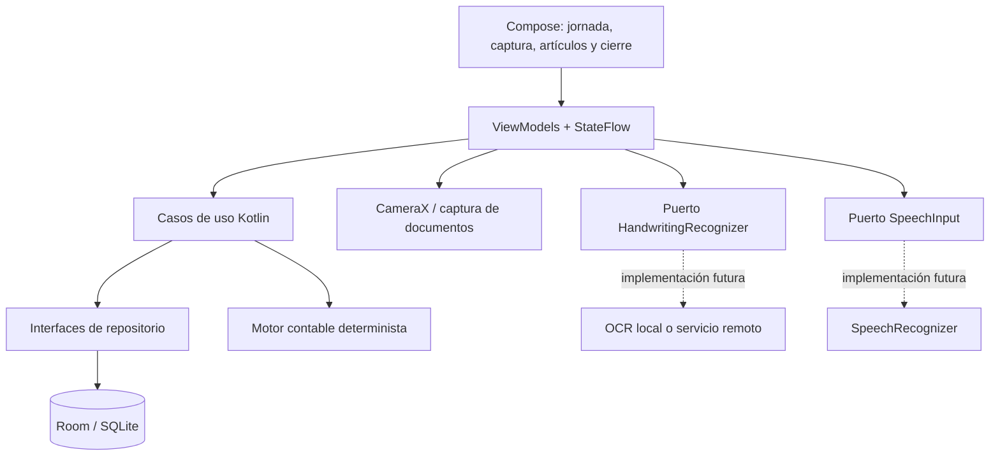

# Arquitectura v0.1 — Control y conciliación de caja (Android)

**Estado:** propuesta inicial para acordar alcance; no es todavía un prompt de implementación.  
**Fecha:** 23 de noviembre de 2026.  
**Objetivo:** construir una aplicación Android sencilla que registre ingresos de habitaciones y ventas de artículos, reciba los totales de cierre de caja y calcule diferencias por medio de pago. Los detalles del negocio se precisarán con cuadernos y tickets reales.

## 1. Alcance y supuestos

### Fuentes de información

1. **Cuaderno de habitaciones:** una página corresponde a un día. Dentro de una región elegida por el usuario figuran número de habitación, persona opcional, monto en pesos enteros (`$500`) y un medio de pago que puede aparecer escrito como «tarjeta» o indicado por color.
2. **Hoja de artículos:** listado manuscrito de productos vendidos y cantidades; sus importes se calculan a partir de un catálogo de precios editable.
3. **Cierre de caja:** totales de tarjeta y efectivo leídos en tickets de cierre, introducidos inicialmente de forma manual y posteriormente por voz.

### Reglas provisionales

- Moneda: **UYU**, valores enteros, almacenados como `Long`, sin punto flotante.
- Fecha: cada **Jornada** agrupa las fuentes de ese día.
- Medios de pago: `EFECTIVO`, `TARJETA`, `SIN_CLASIFICAR`. Nunca asumir efectivo por ausencia de marca.
- La interpretación de colores es configurable y puede no aplicarse en todas las páginas.
- Una lectura manuscrita es **propuesta**, no un ingreso confirmado: debe revisarse antes de incorporarse al estado de caja.
- El cierre de caja es un **valor de contraste**; no se agrega como un segundo ingreso.
- Los precios de artículos se copian a cada venta como precio aplicado para preservar la historia.
- Los totales se obtienen exclusivamente mediante operaciones Kotlin deterministas.
- Si existe importe o medio de pago pendiente de revisión, la conciliación queda **provisional**.
- No asumir todavía cómo se pagan los artículos ni si todos los cierres incluyen las mismas fuentes: los orígenes y medios de pago quedan explícitos para ajustar la regla posteriormente.

## 2. Stack tecnológico

| Capa | Elección | Justificación |
|---|---|---|
| Aplicación | Android nativo, Kotlin | Acceso directo a cámara, micrófono y almacenamiento |
| Interfaz | Jetpack Compose + Material 3 | Interfaz declarativa moderna |
| Estado de pantalla | `ViewModel` + `StateFlow` | Eventos y estado separados de UI |
| Navegación | Navigation para Compose | Rutas y argumentos tipados según versión compatible |
| Persistencia | Room / SQLite | Funcionamiento local sin servidor |
| Concurrencia | Kotlin Coroutines + Flow | Trabajo asíncrono y observación de datos |
| Cámara | CameraX | Fotografías y vista previa |
| Voz (segunda iteración) | `SpeechRecognizer` de Android | Entrada dictada; comprobar disponibilidad y soporte local |
| OCR (segunda iteración) | Adaptador `HandwritingRecognizer` | Probar modelos con imágenes reales antes de elegir |
| Dependencias | Inyección sencilla por constructor al inicio | Evitar Hilt/estructuras complejas hasta que aporten valor |
| Pruebas | JUnit + Room instrumentado | Aritmética, integridad y persistencia |

**Importante:** ML Kit Digital Ink reconoce trazos hechos en pantallas, no fotografías de papel. Para fotos, evaluar ML Kit Text Recognition v2 y un reconocedor de manuscritos basado en imagen (por ejemplo, un servicio remoto), mediante la misma interfaz. No comprometer precisión antes de medirla.

## 3. Arquitectura lógica



### Responsabilidades

- **UI / ViewModel:** visualiza formularios, fotos, propuestas de lectura, estados y resultados; no calcula saldos directamente.
- **Dominio:** interpreta las operaciones ya estructuradas y aplica reglas de negocio, validaciones, sumas y conciliación.
- **Datos:** persiste jornadas, movimientos, ventas, catálogo, cierres y referencias a documentos.
- **Integraciones:** cámara, voz, OCR y clasificación visual de marcas; siempre reemplazables.

## 4. Modelo conceptual mínimo

| Entidad | Campos esenciales |
|---|---|
| `Jornada` | `id`, `fecha`, `estado` (`BORRADOR`, `PROVISIONAL`, `CONCILIADA`) |
| `Documento` | `id`, `jornadaId`, `tipo` (`HABITACIONES`, `ARTICULOS`, `CIERRE`), `rutaLocal`, `zonaSeleccionada?`, `fechaCaptura` |
| `IngresoHabitacion` | `id`, `jornadaId`, `documentoId?`, `habitacion?`, `persona?`, `importe: Long`, `medioPago`, `validado` |
| `Articulo` | `id`, `nombre`, `precioActual: Long`, `activo` |
| `VentaArticulo` | `id`, `jornadaId`, `documentoId?`, `articuloId`, `cantidad: Int`, `precioUnitarioAplicado: Long`, `medioPago`, `validado` |
| `CierreCaja` | `id`, `jornadaId`, `efectivoInformado: Long?`, `tarjetaInformado: Long?`, `origen` (`MANUAL`, `VOZ`), `confirmado` |

**Opcionales para una iteración posterior:** `LecturaOCR` con coordenadas y texto original, `EventoAuditoria` para correcciones, ajustes de caja, saldos anteriores, múltiples cajas y exportación.

**Persistencia de imágenes:** guardar fotografías dentro del almacenamiento privado de la aplicación y únicamente su referencia en Room. La zona seleccionada puede expresarse como coordenadas normalizadas relativas a la imagen original, conservando orientación y dimensiones.

## 5. Cálculo inicial de conciliación

```text
esperado_efectivo = suma(ingresos de habitaciones EFECTIVO)
                  + suma(ventas de artículos EFECTIVO)

esperado_tarjeta  = suma(ingresos de habitaciones TARJETA)
                  + suma(ventas de artículos TARJETA)

diferencia_efectivo = esperado_efectivo - cierre.efectivoInformado
diferencia_tarjeta  = esperado_tarjeta  - cierre.tarjetaInformado
```

- Las ventas de artículos se calculan como `cantidad * precioUnitarioAplicado`, con comprobación de desbordamiento.
- Si el medio de pago de una venta no está determinado, su valor se muestra como **pendiente de clasificación** y no entra arbitrariamente en efectivo ni tarjeta.
- Si falta un total del cierre, **no** se interpreta como cero: queda **sin informar**.
- El estado **conciliado** requiere fuentes revisadas, importes de cierre presentes y diferencias cero (salvo reglas configuradas explícitamente en el futuro).
- El cierre puede ser modificado o confirmado; no duplica movimientos de ventas.

## 6. Flujos de uso

### MVP 0 — Sin IA, con circuito completo

1. Crear o abrir una jornada por fecha.
2. Registrar manualmente ingresos por habitación (importe, habitación opcional, medio de pago).
3. Administrar el catálogo de artículos con precios enteros.
4. Registrar ventas de artículos con cantidad y medio de pago.
5. Introducir manualmente los totales del cierre (efectivo/tarjeta).
6. Mostrar importes esperados, pendientes de clasificación y diferencias.
7. Guardar todo en Room, editar y recuperar tras cerrar y abrir la aplicación.

### MVP 1 — Captura visual

1. Fotografiar página de habitaciones u hoja de artículos con CameraX.
2. Delimitar desde/hasta o recortar una región de lectura.
3. Guardar documento original, fecha y zona elegida.
4. Incorporar un lector OCR detrás de `HandwritingRecognizer`.
5. Presentar los valores propuestos para corrección y confirmación antes de guardarlos.

### MVP 2 — Voz y marcas de pago

1. Incorporar `SpeechInput` y reconocimiento de voz, con transcripción visible y confirmación.
2. Interpretar cantidades enteras y categorías «efectivo/tarjeta» sin delegar cálculos en IA.
3. Incorporar clasificación de «tarjeta» escrita y, luego, marcas por color con umbrales y revisión manual.
4. Medir precisión con datos reales y mejorar detectores sin modificar el dominio.

## 7. Estructura del proyecto (un módulo Gradle inicial)

```text
app/src/main/java/<paquete>/
  MainActivity.kt
  ui/
    navigation/
    jornada/
    habitaciones/
    articulos/
    cierre/
    conciliacion/
    captura/              # MVP 1
  domain/
    model/
    usecase/
    reconciliation/
    ports/                # HandwritingRecognizer, SpeechInput
  data/
    local/                # Room: entidades, DAO, migraciones
    repository/
    camera/               # MVP 1
    recognition/          # MVP 1
    speech/               # MVP 2
```

**No crear** microservicios, sincronización multiusuario, autenticación remota, administración web ni subproyectos Gradle por funcionalidad en el MVP inicial.

## 8. Contratos de integración (diseño; no implementar aún)

```kotlin
interface HandwritingRecognizer {
    suspend fun recognize(document: DocumentInput): RecognitionProposal
}

interface SpeechInput {
    suspend fun captureUtterance(): SpeechTranscript
}

interface ReconciliationEngine {
    fun calculate(input: ReconciliationInput): ReconciliationResult
}
```

La salida `RecognitionProposal` debe conservar texto y región fuente de cada candidato; el motor contable no recibe directamente predicciones sin confirmar.

Si se utiliza IA en la nube, llamar al proveedor desde un backend/proxy seguro, nunca incluir claves privadas en el APK. Ninguna foto debe enviarse sin decisión explícita y reglas de privacidad apropiadas.

## 9. Pantallas mínimas del MVP 0

1. **Jornadas:** listado por fecha, crear/abrir.
2. **Jornada:** resumen de habitaciones, artículos y cierre.
3. **Habitaciones:** agregar/editar/eliminar registros.
4. **Artículos:** precios y ventas de la jornada.
5. **Cierre:** importes informados de efectivo y tarjeta.
6. **Conciliación:** esperado, informado, diferencia y pendientes.

Pueden implementarse como pocas pantallas con pestañas/secciones para reducir código de interfaz.

## 10. Criterios de aceptación del MVP 0

- Crear y volver a abrir una jornada conserva todos los datos y no genera duplicados.
- No aceptar importes negativos, cantidades no positivas ni decimales.
- `0`, `SIN_CLASIFICAR` y `SIN_INFORMAR` son estados diferentes.
- Cambiar el precio de catálogo no altera ventas anteriores.
- El cierre no se suma a los ingresos.
- Cálculos de diferencias comprobados con pruebas unitarias, incluidos casos incompletos y ediciones.
- La app funciona sin internet con todas las funciones del MVP 0.
- No existen APIs ni claves de servicios de IA en esta primera entrega.

## 11. Decisiones pendientes sin bloquear el inicio

- Cómo se interpretan los colores en cada cuaderno y si existen otras marcas.
- Cómo se registran el medio de pago y las cantidades de artículos.
- Qué total exacto representa cada ticket y cómo se relacionan cierres parciales con un día.
- Si existe efectivo inicial, retiros, adelantos, devoluciones o saldo acumulado.
- Cómo se manejan ventas/anotaciones corregidas o anuladas.
- Política de respaldo, exportación y retención de fotos.

Estas incertidumbres deben conservarse como reglas configurables o campos opcionales, no resolverse por suposición.

## Referencias técnicas

- Android Architecture: https://developer.android.com/topic/architecture
- Room: https://developer.android.com/training/data-storage/room
- CameraX: https://developer.android.com/media/camera/camerax
- SpeechRecognizer: https://developer.android.com/reference/android/speech/SpeechRecognizer
- ML Kit Text Recognition v2: https://developers.google.com/ml-kit/vision/text-recognition/v2/android
- ML Kit Digital Ink (solo trazos digitales): https://developers.google.com/ml-kit/vision/digital-ink-recognition/android
